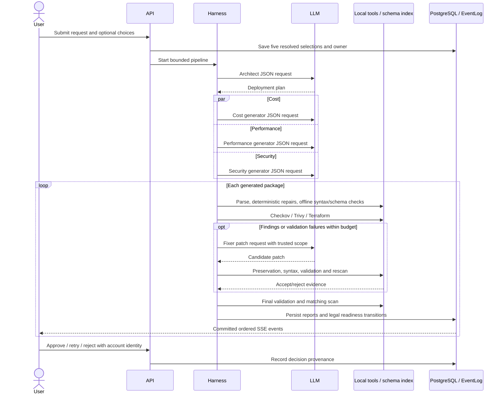

# Agent harness and tool invocations

The Python harness decides which tools run. LLMs receive text and return JSON;
they do not call tools themselves. The OpenAI-compatible path uses Chat
Completions, while the native Anthropic path uses Messages. Neither supplies
model function/tool definitions. A model's suggested source is untrusted input,
never an executable command. No step deploys infrastructure to a cloud.

## Decisions and data flow

| Agent / harness stage | Invocation and decision owner | Inputs → outputs | Limits and failure handling |
|---|---|---|---|
| Orchestrator | Harness creates Architect, then parallel generators, then security/validation per package | Request/configuration → plan, three variants, persisted outcomes | Run-capacity reservation; partial generation survives other variant failures; explicit legal states and ordered EventLog writes |
| Architect | Harness calls the selected LLM adapter; model proposes architecture only | Natural-language request and schema → validated DeploymentPlan, including assumptions/file types | Shared 150-second agent deadline, bounded plan/adapter attempts; malformed responses corrected/retried; safe provider failure categories |
| Cost Generator | Harness calls generator LLM with cost directive | Plan, layout checklist, bounded provider-schema/security guidance → files/notes | Default 8,000 output tokens, 120-second attempt, 150-second shared completion budget; bounded package attempts and schema validation |
| Performance Generator | Same harness path with performance directive | Same plan and authoritative layout → performance files | Same limits; independent outcome and model selection |
| Security Generator | Same harness path with security directive | Same plan and authoritative layout → security files | Same limits; no exemption from later scans or validation |
| Generator finalization / recovery | Harness parses HCL/YAML/JSON, normalizes unambiguous compact HCL, repairs declarations, consults schema index and performs syntax verification | Provisional files → checked/repaired files plus provenance | Token-preserving deterministic normalization; at most two syntax-only LLM rounds and one regeneration, all within original generator budget with finalization reserve; ambiguity stays for repair/failure |
| SecurityAgent | Harness invokes Checkov, Trivy and limited Terraform syntax scanner | Private package workspace → normalized findings, scanner metadata and timing | Scanner default timeout 120 seconds, clipped to remaining stage/iteration; no inherited secrets, no remote updates/downloads; timeout/cancellation kills process group; unusable mandatory scan becomes scan_error |
| SecurityAgent deterministic construction | Harness chooses flagged-resource attribute catalogue and support templates | Parsed exact resource associations, findings and pinned provider schemas → candidate edits | Attribute repairs and KMS/access-log/flow-log/RDS-monitoring templates are conservative, idempotent and bounded; ambiguous context skips with a reason; no severity reduction or suppression |
| Fixer | Harness chooses bounded findings/resources and calls the selected LLM | Existing source, findings, schema excerpts, redacted diagnostics and optional review feedback → typed patch proposal | Default 90-second attempt, clipped to iteration/stage remainder; 16,000 output tokens; resource/finding caps; unsupported paths, suppressions, conflicts and malformed responses reject safely |
| Patch verification | Harness performs preservation checks, native Terraform syntax, changed-document parsing, Helm rendering, Terraform validation and rescan | Proposed edits + retained baseline → accept/reject with diagnostics | No-new-blocker and Terraform non-regression guards; dependency groups kept together; partial acceptance bounded by group cap and same deadline; pending edits discarded on timeout |
| Validator | Harness runs built-in structure/reference/naming/document checks and applicable installed external tools | Current files, plan and scan outcome → per-check validation report | Required Terraform validation cannot be replaced by a missing-tool success. Optional unavailable linters are explicitly skipped. Validation deadline and shared tool semaphore bound work |
| Validation repair | Harness passes failed validation checks to the same Fixer and repeats verification | Failed-check targets + source → candidate files, reduced failure set or rollback | Default two initial rounds in 120 seconds; separate 60-second post-security budget, at most one post-security round; no new blockers; final scan and validation describe retained files |
| Review retry | Harness validates targets, reserves capacity, uses frozen run models/credential reference and invokes Fixer, scanning and validation | Authenticated decision/feedback + current files → audited retry outcome | Existing patch and readiness guards; fresh workspace; interrupted retries settle safely back to review; run completion status remains frozen |

The SecurityAgent defaults to four fix attempts within its 240-second stage
budget. Each iteration includes a 60-second absolute window, normally reserving
five seconds for finalization. Attempted/rejected work consumes allowance.
Configured settings may differ; events/reports retain effective measurements.

## External commands and local indexes

| Tool | Harness invocation / purpose | Output and handling |
|---|---|---|
| Checkov | `checkov -d . -o json --quiet --compact --skip-download --skip-results-upload --framework terraform,kubernetes,helm,dockerfile` | Normalize rule/resource/severity/location; reject ambiguous paths or unusable output; findings stay visible |
| Trivy | `trivy config . --format json --exit-code 0 --quiet --skip-check-update --skip-version-check --disable-telemetry` with private cache | Normalize misconfigurations; telemetry/check downloads disabled; pinned installed scanner is required |
| Terraform syntax scanner | `terraform validate -json -no-color` in copied Terraform directory | Only authoritative configuration-loading/syntax errors become scanner findings; missing provider state does not prove syntax failure |
| Terraform workspace | Harness runs offline `init`, native parsing/`fmt`, and `validate -json` using installed provider mirror | Private initialized module workspaces; provider/dependency changes invalidate reuse; failed/cancelled initialization is not cached; no network provider/module installation |
| Provider schema index | Harness reads version/hash-checked offline provider exports created by `make provider-schema` | Bounded schema excerpts ground generation/fixing; missing/corrupt indexes produce degraded notices, never downloads; Terraform validation remains authoritative |
| Helm | Harness renders changed charts for syntax gates and runs `helm lint ... --skip-schema-validation` when applicable | Rendering/lint diagnostics normalized to package locations; external dependencies are not fetched |
| Hadolint | `hadolint --format json <Dockerfile>` when installed | Typed lint checks; unavailable optional tool recorded as skipped |
| Ansible | `ansible-lint --offline --nocolor -f json --project-dir ansible ...` and applicable `ansible-playbook --syntax-check` | Restricted package paths, isolated Ansible home/collections, no Galaxy installation or dynamic lookups; no playbook execution |
| Promtool | `promtool check config <path>` or `promtool check rules <path>` | Config/rule success or location-based failure; unsafe external file references are rejected; optional absence recorded |

Commands use explicit argv, an executable allowlist and package-contained working
directories. Subprocess environments exclude application credentials. Loopback
refusal proxies and offline flags prevent normal external fetching; these are not
a claim of a complete OS sandbox. Timeouts terminate process groups and bound
cleanup. Tool stdout is private diagnostic input; public reports use redacted,
allowlisted data. LLM thinking text is not persisted or presented as an audit log.

## Sequence

Native function calling would add a model-visible tool schema and a bounded
request/dispatch/result loop. It would require independent authorization, argument
validation, quotas and audit records for every tool request; current subprocess
allowlists and acceptance guards would still apply. Reserving future OAuth and
Responses credential/transport types does not implement that loop.
